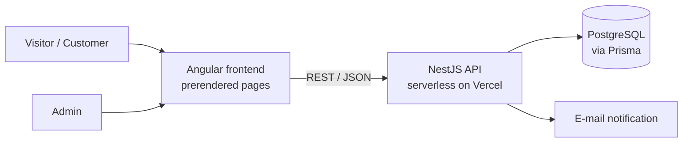

# LuminaSauber — Business Website & Customer Platform

> This repository provides a public overview of a privately maintained software project. The source code is not publicly available.

Production website and a growing business platform for **LuminaSauber**, a cleaning-services business in Düsseldorf, Germany. The project combines an SEO-optimised, prerendered marketing site with an admin dashboard for incoming requests and a customer area.

**Live:** [www.luminasauber.de](https://www.luminasauber.de)

---

## Project Overview

| | |
|---|---|
| **Type** | Full-stack web application (production) |
| **Period** | April 2026 – present |
| **Team** | Solo project |
| **Commits** | 141 (private repository) |
| **Hosting** | Vercel (frontend and serverless backend) |

## Problem & Solution

**Problem:** A small service business needs to be found on Google, convert visitors into enquiries, and manage those enquiries without paid third-party tools.

**Solution:** A prerendered Angular site with dedicated service pages, structured data and a contact form, connected to a NestJS API that stores requests, notifies the business by e-mail and exposes them in a protected admin dashboard.

## Key Features

- Marketing homepage plus **8 dedicated service pages** (hero, services, process, sectors, FAQ, contact)
- **Contact request pipeline:** form → validated API → database → e-mail notification
- **Admin dashboard:** filter, status workflow, archive/delete and print view for requests; customer and document management
- **Customer area:** registration, login and profile
- **SEO:** prerendering, sitemap, structured data (JSON-LD), Open Graph, internal linking, automated SEO checks in the build
- Cookie consent with consent-gated conversion tracking
- Legal pages (imprint, privacy policy, terms)

## Technology Stack

| Layer | Technologies |
|---|---|
| Frontend | Angular 21 (SSR / prerendering), TypeScript, SCSS, Angular Material |
| Backend | NestJS 11, class-validator, JWT authentication, bcrypt, Nodemailer |
| Database | PostgreSQL (Supabase) via Prisma ORM |
| Hosting | Vercel (static frontend + serverless API) |
| Automation | GitHub Actions (scheduled keep-alive job) |
| Testing | Jest (backend), custom SEO test suite |

## System Architecture

**Backend modules:** health, contact, admin auth, customer auth, customers, users, role-based access control, Prisma data layer.
**Data model (simplified):** users, contact requests, customers, orders, offers, invoices, documents.

## My Role & Contributions

Sole developer of the project, responsible for:

- Frontend architecture and UI implementation (including a full redesign in October 2026)
- REST API design and backend modules with NestJS
- Database schema and migrations with Prisma
- Authentication and role-based access for admin and customer areas
- Technical SEO (prerendering, structured data, sitemap, metadata)
- Deployment and hosting configuration on Vercel
- Ongoing maintenance of a live production site

## Development Process

- Iterative development directly against a live production site, tracked in 141 commits
- Written project rules and numbered task specifications used to plan and document changes
- AI-assisted development workflow (coding agents) combined with manual review and testing
- Backlog of future optimisations maintained in the project documentation

See [DEVELOPMENT_LOG.md](DEVELOPMENT_LOG.md) for a month-by-month summary.

## Project Status

**Live in production and under active development.** The marketing site is public; the admin and customer areas are being extended step by step.

## Screenshots

The live website is publicly accessible at [www.luminasauber.de](https://www.luminasauber.de). Screenshots of internal areas (admin dashboard, customer data) are intentionally not published.

## Technical Challenges & Solutions

| Challenge | Solution |
|---|---|
| Single-page apps are hard for search engines to index | Angular prerendering for all public routes, plus sitemap and structured data |
| Running a NestJS backend without a dedicated server | Serverless entry point for the API on Vercel |
| Free-tier database pausing after inactivity | Scheduled GitHub Actions job that keeps the database connection active |
| Tracking conversions in line with GDPR | Conversion tags load only after explicit cookie consent |
| Growing from a website to a business platform | Modular NestJS backend with role-based access, prepared for orders, offers and invoices |

## Skills Demonstrated

`Angular` `TypeScript` `NestJS` `REST API design` `Prisma ORM` `PostgreSQL` `JWT authentication` `RBAC` `Technical SEO` `SSR / prerendering` `Vercel` `GitHub Actions` `GDPR-aware development` `Production maintenance`

---

### About the source code

The original repository is private because it contains the production code and configuration of a running business. This showcase contains documentation only — no source code, configuration or customer data.
